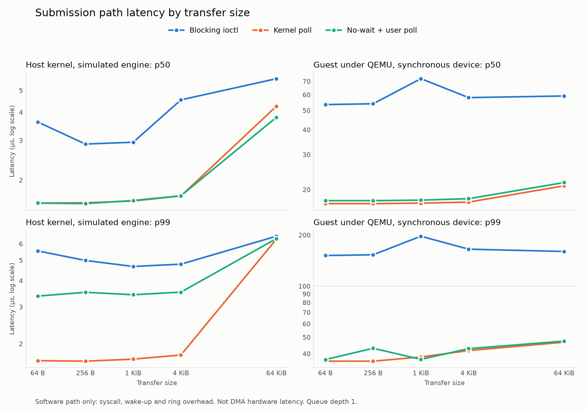
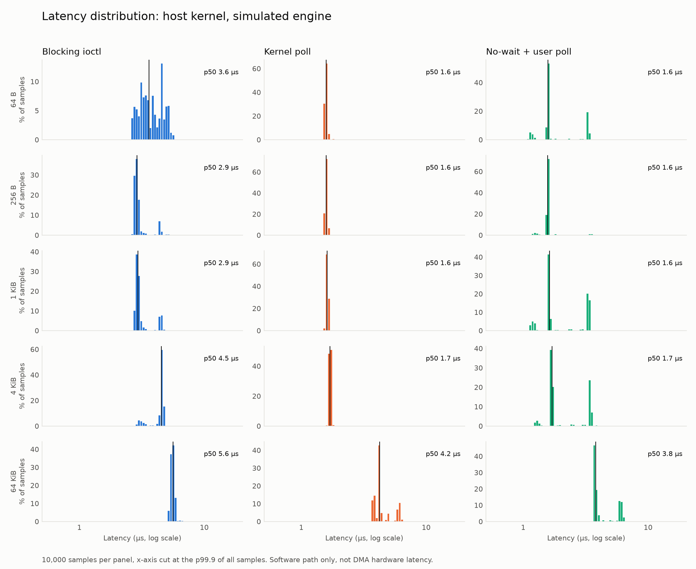

# MMIO DMA Engine: Linux Driver + QEMU Device Model

[](https://github.com/RodeanAzari/DMA-Engine/actions/workflows/ci.yml)

A descriptor-ring DMA peripheral built at three levels of the stack: an emulated PCIe device in QEMU, a Linux kernel driver, and a userspace program that submits transfers and measures them.

The driver has two interchangeable backends. One is a kernel thread on bare metal, which lets the ring protocol be developed on a real kernel in a seconds-long loop. The other is the PCIe device, reached through BAR0 and MSI. The core driver, userspace ABI and tests are the same on both.

**Main result:** avoiding the interrupt wake-up cut p99 submission path latency by 69–81% under QEMU, and by 12–59% on bare metal for transfers up to 4 KiB. Polling from userspace was no better than polling in the kernel. [Results below](#results).


*`dmademo` in the riscv64 QEMU guest, real time: the driver probes the emulated PCIe device, then the three submission paths take turns copying 4 KiB, and every copy is checked byte for byte. The interrupt count at the end equals the number of blocking copies, because only that path asks for an MSI. These are software-path times under emulation, not DMA hardware latency; the measured results come from `dmatest --bench`, below. The recording is also in [docs/imgs/dmademo-guest.cast](docs/imgs/dmademo-guest.cast) for `asciinema play`.*

## Architecture

```
  userspace      dmatest: submit, verify, measure
                    │ ioctl(SUBMIT)          ▲ mmap: data buffer (read/write)
                    │                        │       ring (read-only)
 ═══════════════════│════════════════════════│═══════════════════════════════
  kernel            ▼                        │
                 dmaeng_core.c: char device, ioctl, mmap, ring, completion
                    │ backend ops: reg_read, reg_write, irq_setup, irq_teardown
              ┌─────┴───────────────┐
              ▼                     ▼
       dmaeng_host.c          dmaeng_pci.c
       registers in software  BAR0 readl/writel, MSI
              │                     │
              ▼                     ▼ emulated PCIe
       engine kthread         qemu-device/dmaeng.c (QEMU, riscv64 guest)
              │                     │ pci_dma_read / pci_dma_write    │ MSI
              ▼                     ▼                                 ▼
       ┌──────────────────────────────────────────┐          back to dmaeng_isr
       │ coherent memory: descriptor ring, buffer │
       └──────────────────────────────────────────┘
```

A transfer works like this:

```
 driver                                device
 ──────                                ──────
 fill descriptor at TAIL, set OWN
 wmb()
 write TAIL (doorbell) ──────────────► walk from HEAD while HEAD != TAIL
                                       copy src → dst
                                       write status
                                       clear OWN
                                       advance HEAD
 ISR: read and clear IRQ_STATUS ◄───── MSI on the 0→1 edge of IRQ_STATUS & IRQ_MASK
 wake the waiter
 waiter sees OWN clear, reads status
```

Three submission paths share this ring:

| Path | How it completes | Interrupt |
|---|---|---|
| Blocking ioctl | Sleeps until the ISR wakes it | Yes |
| Kernel poll | Spins on OWN inside the ioctl | No |
| No-wait + user poll | The ioctl returns after the doorbell; userspace spins on OWN through the read-only ring mapping | No |

All three make one syscall per transfer, because the doorbell register is never mapped to userspace. Userspace passes offsets into the mapped buffer, never addresses, so it cannot aim the engine at other memory.

## Register map

All registers are 32-bit, in BAR0. The full bit-field detail is in [docs/register-map.md](docs/register-map.md), which is generated from the single source of truth, [spec/dmaeng.yaml](spec/dmaeng.yaml). The same spec generates the C header and the SystemVerilog package, and CI fails if they drift.

| Offset | Name | Access | Description |
|---|---|---|---|
| `0x00` | `ID` | RO | Magic `0x444D4131` ("DMA1") |
| `0x04` | `VERSION` | RO | `0x00010000` (major.minor) |
| `0x08` | `CTRL` | RW | bit 0 `ENABLE`, bit 1 `RESET` (self-clearing) |
| `0x0C` | `STATUS` | RO | bit 0 `BUSY`, bit 1 `ERROR` |
| `0x10` | `RING_BASE_LO` | RW | Ring address, low 32 bits |
| `0x14` | `RING_BASE_HI` | RW | Ring address, high 32 bits |
| `0x18` | `RING_SIZE` | RW | Descriptor count, power of two, 2–4096 |
| `0x1C` | `HEAD` | RO | Device consume index |
| `0x20` | `TAIL` | RW | Driver produce index; a write is the doorbell |
| `0x24` | `IRQ_STATUS` | RW1C | bit 0 `COMPLETION`, bit 1 `ERROR` |
| `0x28` | `IRQ_MASK` | RW | 1 = enabled |
| `0x2C` | `ERR_CODE` | RO | Last error |
| `0x30` | `MAX_XFER` | RO | Maximum bytes per descriptor, 65536 |

Each descriptor is 32 bytes and little-endian: `src` (64), `dst` (64), `len` (32), `flags` (32: `OWN`, `IRQ`, `LAST`), `status` (32), reserved (32).

## Results

> Measured under QEMU emulation. These figures characterize the **software path** — syscall, interrupt delivery, and ring management overhead — not DMA hardware performance. The device model was run in synchronous mode (`completion-delay-ns=0`), so device-side time is not representative. Delayed-mode results, if shown, include the artificial delay and are labeled as such. The relative comparison between the three submission paths is the meaningful result.

The host figures are real software-path latency on real silicon, with no emulation. Their device is still a simulation: a kernel thread that wakes on the doorbell and runs `memcpy`, so its wake-up time is part of every host number. The host is a ThinkPad T490 (i5-8365U, `powersave` governor, no CPU isolation). Queue depth is 1 throughout, so nothing here says anything about throughput under load.



**What the numbers show:**

- **Dropping the interrupt and wake-up is the win.** In the guest, the polled paths take about 17–22 µs at p50 against about 54–72 µs when blocking. At 64 B the driver measures 38.9 µs from submit to wake when blocking and 3.7 µs when polling, so interrupt delivery and wake-up cost about 35 µs under TCG.
- **Moving the poll into userspace is not.** Both polled paths still make a syscall. In the guest, user poll is slightly slower at p50. On the host, kernel poll has the tighter p99 up to 4 KiB.
- **Emulation overhead is visible in the syscall.** The part of the ioctl outside the driver's submit-to-wake window takes 13–15 µs in the guest and 0.2–0.4 µs on the host.
- **The host's user-poll median is not stable.** Its samples form separate clusters and the mix changes between runs, doubling the 1 KiB and 4 KiB medians from one run to the next while p99 held. The cause was not determined, so the headline uses p99 ranges across two runs. Noise and repeatability are covered in [docs/results.md](docs/results.md).

Every value below is in µs, from run 1, for 10,000 samples per row after 1,000 warmup transfers. Raw samples are in [results/](results/).

<details>
<summary><b>Host kernel, simulated engine</b></summary>

| Path | Size | p50 | p90 | p99 | p99.9 | max |
|---|---:|---:|---:|---:|---:|---:|
| Blocking ioctl | 64 B | 3.62 | 5.02 | 5.54 | 17.77 | 111.14 |
| Blocking ioctl | 256 B | 2.89 | 4.14 | 4.99 | 21.56 | 78.66 |
| Blocking ioctl | 1 KiB | 2.94 | 4.47 | 4.67 | 16.58 | 24.38 |
| Blocking ioctl | 4 KiB | 4.53 | 4.70 | 4.79 | 21.70 | 24.89 |
| Blocking ioctl | 64 KiB | 5.63 | 5.79 | 6.51 | 24.17 | 26.57 |
| Kernel poll | 64 B | 1.58 | 1.62 | 1.66 | 2.50 | 19.72 |
| Kernel poll | 256 B | 1.59 | 1.63 | 1.65 | 1.88 | 19.88 |
| Kernel poll | 1 KiB | 1.61 | 1.66 | 1.69 | 2.35 | 51.05 |
| Kernel poll | 4 KiB | 1.70 | 1.74 | 1.77 | 1.79 | 3.19 |
| Kernel poll | 64 KiB | 4.25 | 6.03 | 6.31 | 22.89 | 662.93 |
| No-wait + user poll | 64 B | 1.58 | 3.30 | 3.37 | 14.67 | 21.95 |
| No-wait + user poll | 256 B | 1.57 | 1.60 | 3.52 | 5.90 | 45.28 |
| No-wait + user poll | 1 KiB | 1.62 | 3.37 | 3.42 | 15.26 | 22.13 |
| No-wait + user poll | 4 KiB | 1.70 | 3.47 | 3.52 | 15.31 | 22.18 |
| No-wait + user poll | 64 KiB | 3.79 | 6.05 | 6.34 | 22.58 | 94.08 |

</details>

<details>
<summary><b>Guest kernel under QEMU, synchronous device</b></summary>

The 1 KiB blocking row is noise: its p50 was 54.0 µs in a second run on a separate boot.

| Path | Size | p50 | p90 | p99 | p99.9 | max |
|---|---:|---:|---:|---:|---:|---:|
| Blocking ioctl | 64 B | 53.50 | 53.80 | 151.50 | 197.20 | 408.60 |
| Blocking ioctl | 256 B | 54.00 | 54.30 | 153.00 | 201.50 | 443.30 |
| Blocking ioctl | 1 KiB | 72.20 | 72.60 | 196.80 | 263.60 | 705.70 |
| Blocking ioctl | 4 KiB | 58.00 | 62.80 | 165.10 | 219.60 | 709.50 |
| Blocking ioctl | 64 KiB | 59.10 | 59.40 | 160.00 | 210.80 | 578.60 |
| Kernel poll | 64 B | 17.00 | 17.10 | 36.10 | 149.10 | 495.50 |
| Kernel poll | 256 B | 17.00 | 17.10 | 36.10 | 128.00 | 144.50 |
| Kernel poll | 1 KiB | 17.10 | 17.20 | 38.20 | 132.70 | 154.60 |
| Kernel poll | 4 KiB | 17.30 | 17.40 | 41.70 | 141.50 | 380.80 |
| Kernel poll | 64 KiB | 20.90 | 21.10 | 46.70 | 136.80 | 528.30 |
| No-wait + user poll | 64 B | 17.60 | 17.70 | 36.90 | 131.90 | 451.30 |
| No-wait + user poll | 256 B | 17.60 | 17.80 | 43.00 | 128.70 | 193.20 |
| No-wait + user poll | 1 KiB | 17.70 | 17.80 | 37.00 | 132.40 | 306.30 |
| No-wait + user poll | 4 KiB | 18.00 | 18.10 | 42.80 | 133.40 | 1,090.60 |
| No-wait + user poll | 64 KiB | 21.70 | 21.80 | 47.40 | 139.20 | 523.80 |

</details>



## Verification

`dmatest` exits non-zero on any failure. It runs on both backends and, in the guest, against both completion modes of the device:

```
-device dmaeng                            # completes inside the doorbell write
-device dmaeng,completion-delay-ns=5000   # completes later, one descriptor per timer tick
```

Delayed mode is the portability check. With synchronous completion, a driver that assumes a transfer is finished by the time `writel` returns passes every test and would then fail on real hardware.

| Mode | What it checks |
|---|---|
| `dmatest` | Ring wrap on each path, sizes 1 B to 64 KiB, position-dependent data with a guard byte, bad offsets and overlap refused, device errors reported and recovered, four concurrent processes, `mmap` limits |
| `dmatest --faults` | Needs a `FAULT_INJECT=1` driver. Bad address, non-zero `_rsvd`, lost interrupt, OWN clear at `HEAD`, misaligned ring and ring fetch fault, each followed by a working copy. With a long completion delay, also a signal during the wait and a submit while a no-wait transfer is in flight |
| `dmatest --bench FILE [N]` | The latency measurements above |

To check the checks, I broke the driver on purpose. Each of these has made `dmatest` fail: a short copy, an overrun, no ring wrap, no recovery after an error, no bounds checks, no `mmap` checks, no mutex, no hardware-error tracking, a writable ring and no `EBUSY`. Twice this found a test that could not fail, and the test was fixed.

Normal builds refuse the fault flags, so a production driver has no way to corrupt a descriptor. Not exercised: an invalid `RING_SIZE` on its own (it shares a branch with the misaligned-ring case), and a signal during the wait on the host backend, whose engine finishes too fast to interrupt.

`-device dmaeng,trace-file=<path>` records every register access and descriptor. [traces/dmaeng-sync.trace](traces/dmaeng-sync.trace) is one such recording, kept as stimulus and expected results for future RTL verification. The format is in [qemu-device/PATCH.md](qemu-device/PATCH.md).

## Development approach

The driver was built against the host kernel first, and ported to the emulated PCIe device once it worked.

Cross-compiling and booting a guest for every edit takes minutes. On a dedicated machine that can crash without consequence, `make && insmod` takes seconds, on a real kernel with real oopses. So the ring, ownership protocol, completion path, ioctl ABI and `mmap` were all written behind a four-function backend interface, first against a kernel thread implementing the same register semantics in software.

That had two other effects. A working driver existed before any device model did, so the riskiest part of the plan could fail without taking the whole project with it. And when the PCI backend arrived, only about 150 new lines were needed, and the existing test suite passed against the new device.

The host backend delivers completions through a hard `irq_work`, so the shared ISR always runs in hardirq context, as it does with MSI.

## Relationship to my RISC-V SoC project

This device shares its register map and descriptor format with the AXI DMA engine planned for my RISC-V SoC, and it is the software rehearsal for a later PCIe implementation on an FPGA. The RTL is not part of this repository.

**What carries over:** the spec and generated headers, the core driver, the userspace ABI and tests, and the recorded traces. Moving to real PCIe hardware should need a new device ID in `dmaeng_pci.c`, not a new driver. Memory barriers, DMA addresses from `dma_alloc_coherent` and the delayed-completion test are all there because hardware will not forgive what QEMU does.

**What does not:** PCIe link bring-up, timing closure and board constraints can't be done ahead of time in software.

## Build from clean

Tested on Debian 13 (x86-64). Disable Secure Boot, or `insmod` will refuse the unsigned module. These steps build QEMU and Buildroot from source. A from-scratch run of exactly these steps on the T490 (i5-8365U, `-j4`) took 87 minutes, 83 of them in Buildroot, and used 18 GB of disk.

**Host, in `~`: install dependencies and clone**

```sh
sudo apt install build-essential git flex bison ninja-build python3-venv \
    pkg-config libglib2.0-dev libpixman-1-dev bc cpio rsync unzip file wget \
    linux-headers-$(uname -r)
git clone https://github.com/RodeanAzari/DMA-Engine.git
```

**Host, in `~/DMA-Engine`: run on the bare-metal backend**

```sh
make
sudo insmod driver/dmaeng-host.ko
sudo userspace/dmatest
sudo rmmod dmaeng_host
```

**Host, in `~`: build QEMU with the device**

```sh
wget https://download.qemu.org/qemu-11.1.2.tar.xz
tar xf qemu-11.1.2.tar.xz
DMA-Engine/scripts/install-qemu-device.sh ~/qemu-11.1.2
cd ~/qemu-11.1.2
./configure --target-list=riscv64-softmmu --enable-debug
make -j4
```

**Host, in `~`: build the guest image.** The details are in [buildroot/setup.md](buildroot/setup.md).

```sh
wget https://buildroot.org/downloads/buildroot-2026.08.tar.gz
tar xf buildroot-2026.08.tar.gz
cd buildroot-2026.08
make qemu_riscv64_virt_defconfig
make -j4
```

**Host, in `~/DMA-Engine`: cross-build for the guest and serve the files**

```sh
cd ~/DMA-Engine
make clean
BR=~/buildroot-2026.08/output
export ARCH=riscv CROSS_COMPILE=$BR/host/bin/riscv64-buildroot-linux-gnu- KDIR=$BR/build/linux-6.18.7
make -C driver
make -C userspace CC=${CROSS_COMPILE}gcc
unset ARCH CROSS_COMPILE KDIR
mkdir -p /tmp/www && cp driver/dmaeng-pci.ko userspace/dmatest userspace/dmademo /tmp/www
(cd /tmp/www && python3 -m http.server 8000)
```

**A second host terminal, in `~/DMA-Engine`: boot the guest.** Log in as `root`, no password. Add `,completion-delay-ns=5000` to the device for delayed completion.

```sh
scripts/run-qemu.sh -device dmaeng
```

**Inside the guest, in `/tmp`: run on the PCIe device**

```sh
cd /tmp
wget http://10.0.2.2:8000/dmaeng-pci.ko http://10.0.2.2:8000/dmatest http://10.0.2.2:8000/dmademo
chmod +x dmatest dmademo
lspci | grep 1234
insmod dmaeng-pci.ko
./dmatest
grep dmaeng /proc/interrupts
```

Output from that clean run:

```
00:01.0 Class 0880: 1234:dead
buffer 1048576 B, ring 256, max_xfer 65536
ring wrap: 521 copies, 1 B to 65536 B
path blocking: 264 copies
path kernel_poll: 264 copies
path user_poll: 264 copies
driver rejected bad offsets, overlap and flags
device errors reported, driver recovered
no-wait error seen in the ring, driver recovered
concurrent: 4 processes, 200 copies each
mmap limits enforced
ALL OK
 17:       1190 PCI-MSI-0000:00:01.0   0 Edge      dmaeng
```

`./dmademo` then gives the live view shown at the top, for 15 seconds by default (`./dmademo SECONDS BYTES`). It runs on the host backend too.

To regenerate the plots and tables from the raw samples, install `matplotlib` and run `scripts/plot-latency.py` from the repo root.

## Repository layout

| Path | Contents |
|---|---|
| `spec/dmaeng.yaml` | Single source of truth for registers and descriptor |
| `include/`, `rtl/`, `docs/register-map.md` | Generated from the spec by `scripts/gen-regs.py` |
| `qemu-device/` | The QEMU device model |
| `driver/` | Core driver, host backend, PCI backend, userspace ABI |
| `userspace/` | `dmatest`: tests and benchmark; `dmademo`: live view |
| `results/`, `docs/results.md` | Raw samples and full analysis |
| `traces/` | Recorded device trace for future RTL verification |

## License

GPL-2.0 ([LICENSE](LICENSE)). The QEMU device model is GPL-2.0-or-later, matching QEMU.
