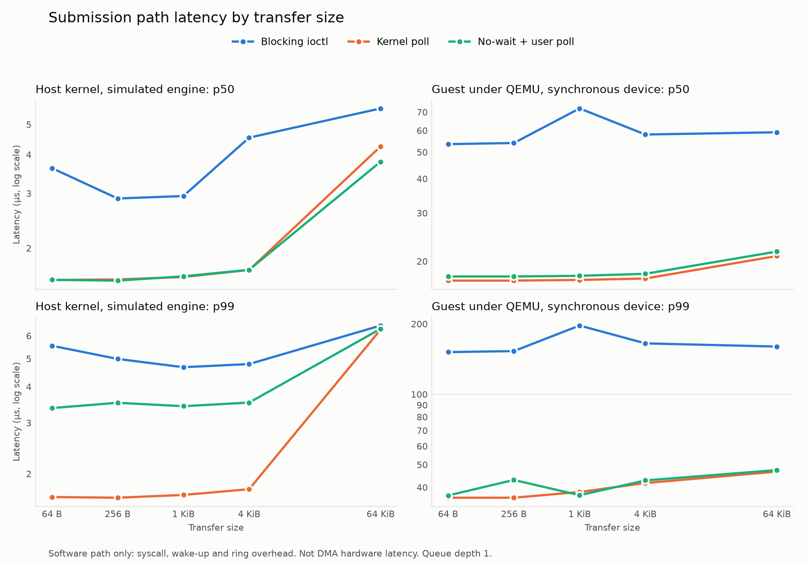
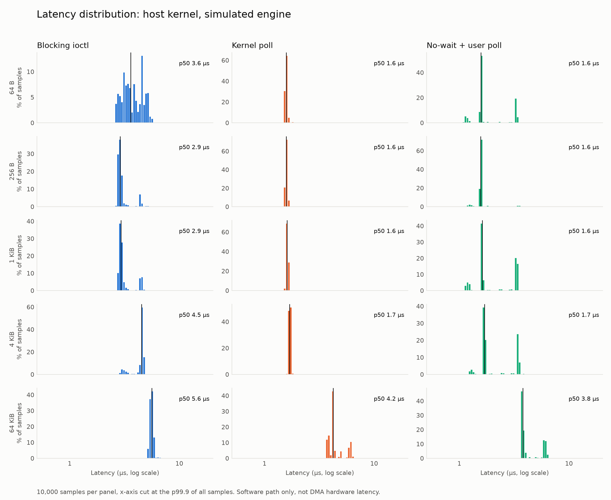
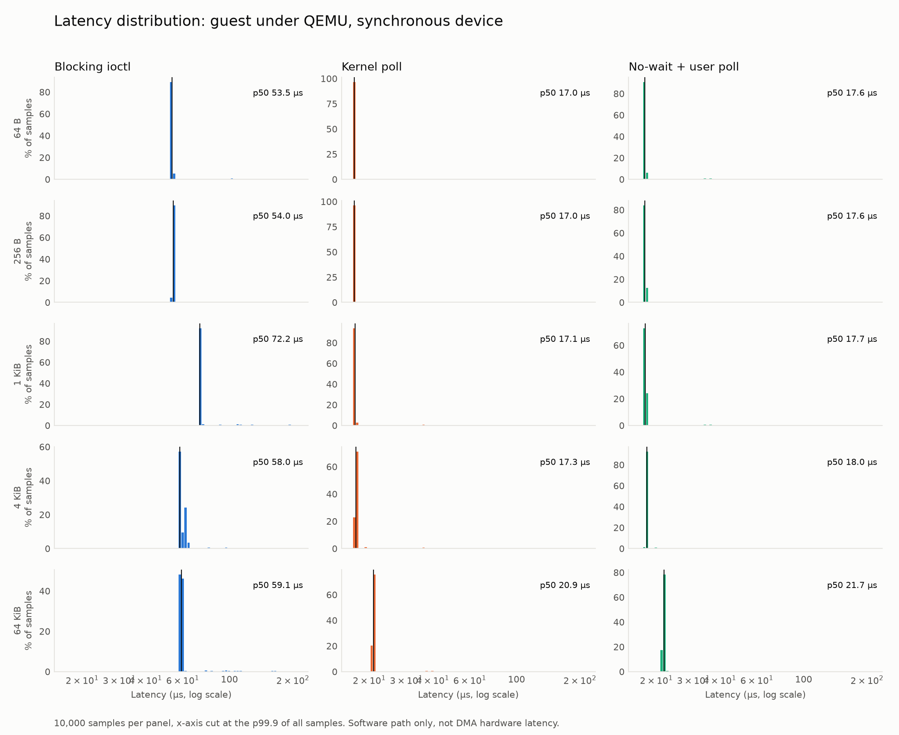

# Results

> Measured under QEMU emulation. These figures characterize the **software path** — syscall, interrupt delivery, and ring management overhead — not DMA hardware performance. The device model was run in synchronous mode (`completion-delay-ns=0`), so device-side time is not representative. Delayed-mode results, if shown, include the artificial delay and are labeled as such. The relative comparison between the three submission paths is the meaningful result.

The host figures are real software-path latency on real silicon, with no emulation. Their device is still a simulation: a kernel thread that wakes on the doorbell and runs `memcpy`, so its wake-up time is part of every host number.

## What the numbers show

**Dropping the interrupt and wake-up is the win. Moving the poll into userspace is not.**

- **Guest:** both polled paths take about 17–22 µs at p50 against about 54–72 µs for the blocking ioctl. Comparing no-wait + user poll to blocking, p99 falls by 69–81% across both runs.
- **Host:** kernel poll takes 1.6–1.7 µs up to 4 KiB, against 2.9–4.5 µs for blocking. For no-wait + user poll, p99 falls by 12–59% up to 4 KiB but only 3% at 64 KiB, where the `memcpy` and the other noise dominate.
- **The two polled paths are nearly equal.** Both still make one syscall per transfer, because the doorbell never reaches userspace. In the guest, user poll is slightly slower at p50 (17.6 vs. 17.0 µs at 64 B). On the host, kernel poll has the tighter p99 up to 4 KiB (about 1.7 vs. 3.4 µs).
- **Where guest time goes:** at 64 B, the driver measures 38.9 µs from submit to wake when blocking and 3.7 µs when polling, so interrupt delivery and wake-up cost about 35 µs under TCG. The rest of the ioctl takes about 13–15 µs in the guest and 0.2–0.4 µs on the host, which is the emulation overhead showing up in a syscall.
- **Size barely matters up to 4 KiB.** At 64 KiB, kernel poll grows by about 2.5 µs on the host and 3.6 µs in the guest. Queue depth is 1 throughout, so none of this says anything about throughput under load.

## Noise and limits

- **The host's user-poll p50 is not stable.** Its samples fall into separate clusters near 1.2, 1.6 and 3.4 µs, and the share in each changes between runs, so the 1 KiB and 4 KiB medians doubled from run 1 to run 2 while p99 held. Read the histogram, not the median. The cause was not determined.
- **The host's blocking path is bimodal too**, so its p50 moves with size in ways the copy cannot explain, such as 2.94 µs at 1 KiB and 4.53 µs at 4 KiB.
- **The guest's 1 KiB blocking spike in the chart is noise.** It was 72.2 µs in run 1 and 54.0 µs in run 2, a separate boot.
- **The 5 µs delayed run adds far more than 5 µs to the blocking path** (about 88 µs against 54 µs at 64 B). It also makes user poll faster than kernel poll (about 21 vs. 25–29 µs). Neither effect was investigated, so that dataset is shown only to demonstrate delayed mode.
- **Platform:** ThinkPad T490, i5-8365U, on AC power, `powersave` governor, no CPU isolation, Linux 6.12. The benchmark pins itself to the last CPU and calls `mlockall`. The guest runs under TCG on one vCPU, Linux 6.18. Maximums are single samples.

## Method

`dmatest --bench` makes 10,000 timed transfers per path and size after 1,000 warmup transfers, using `CLOCK_MONOTONIC` in userspace around the whole submission. For no-wait it stops when OWN is seen clear. The copied data is checked at the end of each configuration. Raw samples are in `results/`. Percentiles are computed offline by `scripts/plot-latency.py`, using nearest rank.

## Distributions

## Tables

<!-- BEGIN GENERATED -->
### Host kernel, simulated engine (T490, real silicon)

All values in µs, measured in userspace.

| Path | Size | p50 | p90 | p99 | p99.9 | max |
|---|---:|---:|---:|---:|---:|---:|
| Blocking ioctl | 64 B | 3.62 | 5.02 | 5.54 | 17.77 | 111.14 |
| Blocking ioctl | 256 B | 2.89 | 4.14 | 4.99 | 21.56 | 78.66 |
| Blocking ioctl | 1 KiB | 2.94 | 4.47 | 4.67 | 16.58 | 24.38 |
| Blocking ioctl | 4 KiB | 4.53 | 4.70 | 4.79 | 21.70 | 24.89 |
| Blocking ioctl | 64 KiB | 5.63 | 5.79 | 6.51 | 24.17 | 26.57 |
| Kernel poll | 64 B | 1.58 | 1.62 | 1.66 | 2.50 | 19.72 |
| Kernel poll | 256 B | 1.59 | 1.63 | 1.65 | 1.88 | 19.88 |
| Kernel poll | 1 KiB | 1.61 | 1.66 | 1.69 | 2.35 | 51.05 |
| Kernel poll | 4 KiB | 1.70 | 1.74 | 1.77 | 1.79 | 3.19 |
| Kernel poll | 64 KiB | 4.25 | 6.03 | 6.31 | 22.89 | 662.93 |
| No-wait + user poll | 64 B | 1.58 | 3.30 | 3.37 | 14.67 | 21.95 |
| No-wait + user poll | 256 B | 1.57 | 1.60 | 3.52 | 5.90 | 45.28 |
| No-wait + user poll | 1 KiB | 1.62 | 3.37 | 3.42 | 15.26 | 22.13 |
| No-wait + user poll | 4 KiB | 1.70 | 3.47 | 3.52 | 15.31 | 22.18 |
| No-wait + user poll | 64 KiB | 3.79 | 6.05 | 6.34 | 22.58 | 94.08 |

### Guest kernel under QEMU TCG, synchronous device (`completion-delay-ns=0`)

All values in µs, measured in userspace.

| Path | Size | p50 | p90 | p99 | p99.9 | max |
|---|---:|---:|---:|---:|---:|---:|
| Blocking ioctl | 64 B | 53.50 | 53.80 | 151.50 | 197.20 | 408.60 |
| Blocking ioctl | 256 B | 54.00 | 54.30 | 153.00 | 201.50 | 443.30 |
| Blocking ioctl | 1 KiB | 72.20 | 72.60 | 196.80 | 263.60 | 705.70 |
| Blocking ioctl | 4 KiB | 58.00 | 62.80 | 165.10 | 219.60 | 709.50 |
| Blocking ioctl | 64 KiB | 59.10 | 59.40 | 160.00 | 210.80 | 578.60 |
| Kernel poll | 64 B | 17.00 | 17.10 | 36.10 | 149.10 | 495.50 |
| Kernel poll | 256 B | 17.00 | 17.10 | 36.10 | 128.00 | 144.50 |
| Kernel poll | 1 KiB | 17.10 | 17.20 | 38.20 | 132.70 | 154.60 |
| Kernel poll | 4 KiB | 17.30 | 17.40 | 41.70 | 141.50 | 380.80 |
| Kernel poll | 64 KiB | 20.90 | 21.10 | 46.70 | 136.80 | 528.30 |
| No-wait + user poll | 64 B | 17.60 | 17.70 | 36.90 | 131.90 | 451.30 |
| No-wait + user poll | 256 B | 17.60 | 17.80 | 43.00 | 128.70 | 193.20 |
| No-wait + user poll | 1 KiB | 17.70 | 17.80 | 37.00 | 132.40 | 306.30 |
| No-wait + user poll | 4 KiB | 18.00 | 18.10 | 42.80 | 133.40 | 1,090.60 |
| No-wait + user poll | 64 KiB | 21.70 | 21.80 | 47.40 | 139.20 | 523.80 |

### Guest kernel under QEMU TCG, **includes an artificial 5 µs device delay** (`completion-delay-ns=5000`)

All values in µs, measured in userspace.

| Path | Size | p50 | p90 | p99 | p99.9 | max |
|---|---:|---:|---:|---:|---:|---:|
| Blocking ioctl | 64 B | 87.70 | 154.30 | 299.90 | 341.60 | 491.00 |
| Blocking ioctl | 256 B | 87.60 | 155.30 | 299.10 | 345.80 | 464.90 |
| Blocking ioctl | 1 KiB | 83.30 | 139.10 | 230.90 | 320.80 | 449.30 |
| Blocking ioctl | 4 KiB | 89.80 | 179.30 | 332.90 | 372.80 | 829.20 |
| Blocking ioctl | 64 KiB | 144.70 | 283.30 | 320.30 | 349.40 | 890.40 |
| Kernel poll | 64 B | 28.90 | 29.20 | 49.90 | 127.40 | 398.80 |
| Kernel poll | 256 B | 25.30 | 29.10 | 46.60 | 117.00 | 345.70 |
| Kernel poll | 1 KiB | 24.90 | 29.50 | 44.00 | 116.40 | 395.60 |
| Kernel poll | 4 KiB | 25.00 | 29.90 | 47.90 | 116.80 | 157.70 |
| Kernel poll | 64 KiB | 27.80 | 28.60 | 49.00 | 120.70 | 278.90 |
| No-wait + user poll | 64 B | 20.60 | 21.30 | 26.30 | 108.70 | 151.70 |
| No-wait + user poll | 256 B | 21.00 | 21.40 | 25.80 | 115.90 | 305.30 |
| No-wait + user poll | 1 KiB | 21.20 | 21.80 | 27.50 | 126.30 | 318.80 |
| No-wait + user poll | 4 KiB | 21.20 | 21.90 | 27.50 | 121.50 | 312.70 |
| No-wait + user poll | 64 KiB | 24.30 | 24.80 | 39.00 | 128.50 | 378.90 |

### Blocking ioctl vs. no-wait + user poll

**Host kernel, simulated engine (T490, real silicon)**, run 1, µs

| Size | Blocking p50 | User poll p50 | p50 change | Blocking p99 | User poll p99 | p99 change |
|---:|---:|---:|---:|---:|---:|---:|
| 64 B | 3.62 | 1.58 | -56% | 5.54 | 3.37 | -39% |
| 256 B | 2.89 | 1.57 | -46% | 4.99 | 3.52 | -29% |
| 1 KiB | 2.94 | 1.62 | -45% | 4.67 | 3.42 | -27% |
| 4 KiB | 4.53 | 1.70 | -62% | 4.79 | 3.52 | -26% |
| 64 KiB | 5.63 | 3.79 | -33% | 6.51 | 6.34 | -3% |

**Guest kernel under QEMU TCG, synchronous device (`completion-delay-ns=0`)**, run 1, µs

| Size | Blocking p50 | User poll p50 | p50 change | Blocking p99 | User poll p99 | p99 change |
|---:|---:|---:|---:|---:|---:|---:|
| 64 B | 53.50 | 17.60 | -67% | 151.50 | 36.90 | -76% |
| 256 B | 54.00 | 17.60 | -67% | 153.00 | 43.00 | -72% |
| 1 KiB | 72.20 | 17.70 | -75% | 196.80 | 37.00 | -81% |
| 4 KiB | 58.00 | 18.00 | -69% | 165.10 | 42.80 | -74% |
| 64 KiB | 59.10 | 21.70 | -63% | 160.00 | 47.40 | -70% |

**Host, run 2**, µs

| Size | Blocking p50 | User poll p50 | p50 change | Blocking p99 | User poll p99 | p99 change |
|---:|---:|---:|---:|---:|---:|---:|
| 64 B | 3.06 | 1.56 | -49% | 4.27 | 1.77 | -59% |
| 256 B | 3.07 | 1.58 | -49% | 3.72 | 3.28 | -12% |
| 1 KiB | 2.97 | 3.30 | +11% | 4.78 | 3.41 | -29% |
| 4 KiB | 4.55 | 3.42 | -25% | 4.82 | 3.53 | -27% |
| 64 KiB | 5.64 | 3.82 | -32% | 6.47 | 6.30 | -3% |

**Guest, synchronous, run 2**, µs

| Size | Blocking p50 | User poll p50 | p50 change | Blocking p99 | User poll p99 | p99 change |
|---:|---:|---:|---:|---:|---:|---:|
| 64 B | 53.80 | 17.50 | -67% | 117.90 | 36.60 | -69% |
| 256 B | 53.90 | 17.50 | -68% | 130.50 | 37.30 | -71% |
| 1 KiB | 54.00 | 17.50 | -68% | 153.10 | 36.90 | -76% |
| 4 KiB | 55.50 | 17.90 | -68% | 158.70 | 37.20 | -77% |
| 64 KiB | 60.40 | 21.70 | -64% | 162.50 | 49.70 | -69% |

### Time inside and outside the driver's submit-to-wake window

**Host kernel, simulated engine (T490, real silicon)**, µs

| Path | Size | Driver-measured p50 | Rest of the ioctl, p50 |
|---|---:|---:|---:|
| Blocking ioctl | 64 B | 3.22 | 0.40 |
| Blocking ioctl | 256 B | 2.54 | 0.35 |
| Blocking ioctl | 1 KiB | 2.59 | 0.35 |
| Blocking ioctl | 4 KiB | 4.10 | 0.43 |
| Blocking ioctl | 64 KiB | 5.31 | 0.32 |
| Kernel poll | 64 B | 1.34 | 0.23 |
| Kernel poll | 256 B | 1.35 | 0.23 |
| Kernel poll | 1 KiB | 1.38 | 0.23 |
| Kernel poll | 4 KiB | 1.46 | 0.24 |
| Kernel poll | 64 KiB | 4.02 | 0.23 |

**Guest kernel under QEMU TCG, synchronous device (`completion-delay-ns=0`)**, µs

| Path | Size | Driver-measured p50 | Rest of the ioctl, p50 |
|---|---:|---:|---:|
| Blocking ioctl | 64 B | 38.90 | 14.60 |
| Blocking ioctl | 256 B | 39.30 | 14.70 |
| Blocking ioctl | 1 KiB | 53.10 | 19.10 |
| Blocking ioctl | 4 KiB | 43.00 | 15.00 |
| Blocking ioctl | 64 KiB | 44.00 | 15.00 |
| Kernel poll | 64 B | 3.70 | 13.30 |
| Kernel poll | 256 B | 3.70 | 13.30 |
| Kernel poll | 1 KiB | 3.80 | 13.30 |
| Kernel poll | 4 KiB | 4.00 | 13.40 |
| Kernel poll | 64 KiB | 7.00 | 13.90 |

### Repeatability

**Host, two runs on one module load**, µs

| Path | Size | Run 1 p50 | Run 2 p50 | Difference | Run 1 p99 | Run 2 p99 | Difference |
|---|---:|---:|---:|---:|---:|---:|---:|
| Blocking ioctl | 64 B | 3.62 | 3.06 | -15% | 5.54 | 4.27 | -23% |
| Blocking ioctl | 256 B | 2.89 | 3.07 | +6% | 4.99 | 3.72 | -25% |
| Blocking ioctl | 1 KiB | 2.94 | 2.97 | +1% | 4.67 | 4.78 | +2% |
| Blocking ioctl | 4 KiB | 4.53 | 4.55 | +0% | 4.79 | 4.82 | +1% |
| Blocking ioctl | 64 KiB | 5.63 | 5.64 | +0% | 6.51 | 6.47 | -1% |
| Kernel poll | 64 B | 1.58 | 1.57 | -0% | 1.66 | 1.81 | +9% |
| Kernel poll | 256 B | 1.59 | 1.58 | -0% | 1.65 | 1.77 | +7% |
| Kernel poll | 1 KiB | 1.61 | 1.60 | -1% | 1.69 | 1.80 | +7% |
| Kernel poll | 4 KiB | 1.70 | 1.70 | +0% | 1.77 | 1.75 | -1% |
| Kernel poll | 64 KiB | 4.25 | 4.25 | +0% | 6.31 | 6.14 | -3% |
| No-wait + user poll | 64 B | 1.58 | 1.56 | -1% | 3.37 | 1.77 | -48% |
| No-wait + user poll | 256 B | 1.57 | 1.58 | +0% | 3.52 | 3.28 | -7% |
| No-wait + user poll | 1 KiB | 1.62 | 3.30 | +103% | 3.42 | 3.41 | -0% |
| No-wait + user poll | 4 KiB | 1.70 | 3.42 | +101% | 3.52 | 3.53 | +0% |
| No-wait + user poll | 64 KiB | 3.79 | 3.82 | +1% | 6.34 | 6.30 | -1% |

**Guest, synchronous, two separate boots**, µs

| Path | Size | Run 1 p50 | Run 2 p50 | Difference | Run 1 p99 | Run 2 p99 | Difference |
|---|---:|---:|---:|---:|---:|---:|---:|
| Blocking ioctl | 64 B | 53.50 | 53.80 | +1% | 151.50 | 117.90 | -22% |
| Blocking ioctl | 256 B | 54.00 | 53.90 | -0% | 153.00 | 130.50 | -15% |
| Blocking ioctl | 1 KiB | 72.20 | 54.00 | -25% | 196.80 | 153.10 | -22% |
| Blocking ioctl | 4 KiB | 58.00 | 55.50 | -4% | 165.10 | 158.70 | -4% |
| Blocking ioctl | 64 KiB | 59.10 | 60.40 | +2% | 160.00 | 162.50 | +2% |
| Kernel poll | 64 B | 17.00 | 16.90 | -1% | 36.10 | 36.10 | +0% |
| Kernel poll | 256 B | 17.00 | 17.00 | +0% | 36.10 | 36.10 | +0% |
| Kernel poll | 1 KiB | 17.10 | 17.00 | -1% | 38.20 | 36.30 | -5% |
| Kernel poll | 4 KiB | 17.30 | 17.30 | +0% | 41.70 | 36.40 | -13% |
| Kernel poll | 64 KiB | 20.90 | 21.00 | +0% | 46.70 | 46.70 | +0% |
| No-wait + user poll | 64 B | 17.60 | 17.50 | -1% | 36.90 | 36.60 | -1% |
| No-wait + user poll | 256 B | 17.60 | 17.50 | -1% | 43.00 | 37.30 | -13% |
| No-wait + user poll | 1 KiB | 17.70 | 17.50 | -1% | 37.00 | 36.90 | -0% |
| No-wait + user poll | 4 KiB | 18.00 | 17.90 | -1% | 42.80 | 37.20 | -13% |
| No-wait + user poll | 64 KiB | 21.70 | 21.70 | +0% | 47.40 | 49.70 | +5% |

<!-- END GENERATED -->
